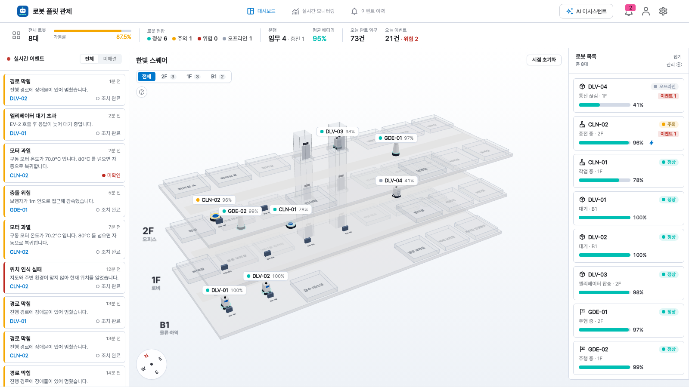
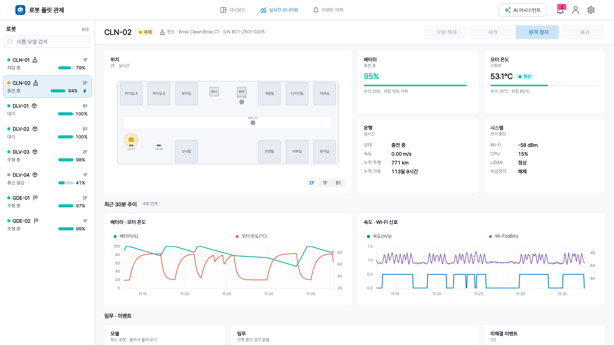
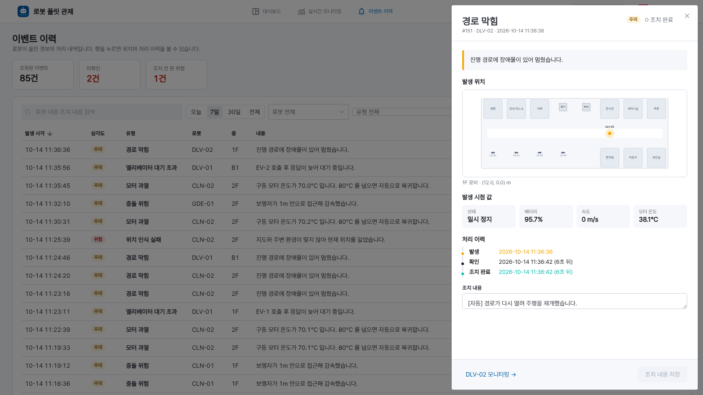
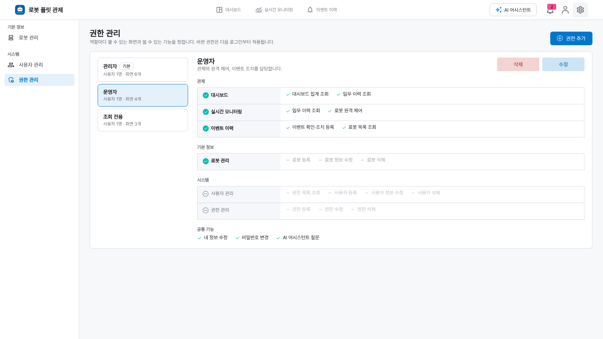

# 로봇 플릿 관제 (Robot Fleet Monitor)

실내 자율주행 로봇(배송·안내·청소) 여러 대를 한 화면에서 관제하는 웹 대시보드입니다.
건물 3D 지도 위에서 로봇이 실시간으로 움직이고, 이벤트가 생기면 바로 알리고,
원격으로 멈추거나 복귀시킬 수 있습니다.

서버 없이도 돌아갑니다. 브라우저 안에서 **플릿 시뮬레이터**와 **목 API(MSW)**가
함께 떠서, 로봇 8대가 임무를 받고 엘리베이터를 타고 충전하며 가끔 장애를 일으킵니다.



## 화면

| 화면 | 하는 일 |
| --- | --- |
| **대시보드** | 3층 건물 3D 지도, 로봇 위치·경로·상태, 실시간 이벤트 피드, 가동률·배터리·오늘 임무 집계 |
| **실시간 모니터링** | 로봇 한 대의 3D 모델·평면도 위치, 배터리·모터 온도·통신, 30분 추이 차트, 임무 이력, 원격 제어, 로봇별 AI 채팅 및 대화 기록 |
| **이벤트 이력** | 기간·로봇·유형·심각도·처리 상태 필터, 발생 위치 지도, 확인·조치 완료 처리와 조치 내용 기록 |
| **로봇 관리** | 로봇 등록·수정·삭제, 충전 스테이션 지정 (등록하면 바로 시뮬레이션에 투입) |
| **사용자 · 권한 관리** | 사용자 관리, 역할별 화면·기능 권한 편집 |

| 실시간 모니터링 | 이벤트 상세 |
| --- | --- |
|  |  |

| 권한 관리 |
| --- |
|  |

## 실행

Node 20 이상, pnpm 8 이상이 필요합니다.

```bash
pnpm install
pnpm dev          # http://localhost:15160
```

데모 계정 (로그인 화면에도 나옵니다)

| 아이디 | 비밀번호 | 권한 |
| --- | --- | --- |
| `admin` | `admin1234` | 관리자 — 전부 |
| `operator` | `operator1234` | 운영자 — 관제·원격 제어·이벤트 조치, 로봇 정보는 조회만 |
| `viewer` | `viewer1234` | 조회 전용 — 화면만 볼 수 있음 |

로봇·사용자·권한과 사용자별 로봇 AI 대화 기록은 브라우저 localStorage 에 남습니다.
처음 상태로 돌리려면 개발자 도구 콘솔에서
`localStorage.removeItem("rfm.mock.db")` 후 새로고침하세요.

### 스크립트

| 명령 | 설명 |
| --- | --- |
| `pnpm dev` | 개발 서버 |
| `pnpm build` | lint → 타입 검사 → `build/` 에 배포용 빌드 |
| `pnpm preview` | 빌드 결과 미리보기 |
| `pnpm test` | 단위 테스트 (vitest) — 경로 탐색, 시뮬레이터, 상태 판정 |
| `pnpm lint` / `pnpm typecheck` | 정적 검사 |

## 기술 스택

React 18 · TypeScript · Vite · Elastic UI · three.js (react-three-fiber, drei) ·
Elastic Charts · ky · React Router 5

## 구조

```
src/
├─ core/                 화면과 무관한 기반
│  ├─ resources/         API 호출 + 상태를 묶은 "리소스" (권한 단위)
│  ├─ telemetry/         실시간 값 공급원 인터페이스와 구독 훅
│  ├─ types/robot.ts     도메인 타입과 상태 판정 규칙
│  └─ utils/page.tsx     화면 등록·권한 판정
├─ components/
│  ├─ dashboard/         대시보드 + building3d/(3D 건물 지도)
│  ├─ monitoring/        로봇 상세 모니터링, 평면도, 추이 차트
│  ├─ events/            이벤트 목록·상세
│  ├─ robots/            로봇 관리
│  ├─ system/            사용자·권한 관리
│  ├─ model/robot/       절차적으로 만든 로봇 3D 모델
│  └─ common/            공통 UI
├─ pages/                화면 등록 (경로·권한·필요한 리소스 선언)
└─ mock/                 데모용 목 API(MSW)와 플릿 시뮬레이터
   ├─ handlers.ts        /api/* 요청 처리기 (MSW 핸들러)
   ├─ browser.ts         서비스 워커로 브라우저에서 켜기
   ├─ fleet/simulator.ts 로봇 이동·배터리·임무·장애 시뮬레이션
   ├─ fleet/graph.ts     경유점 그래프와 최단 경로 (엘리베이터 포함)
   └─ site.ts            가상 시설 "한빛 스퀘어" 지도
```

### 권한 모델

화면(`Page`)과 기능(`Resource`)마다 문자열 키가 있습니다(`robots`, `robot:list` 처럼 `도메인:동작`).
로그인 토큰의 `pages`, `resources` 목록에 그 키가 들어 있어야 쓸 수 있습니다.

- 화면은 `registerPage({ page, resources, optionalResources })` 로 필요한 리소스을 선언합니다.
  `resources` 는 화면을 열면 늘 쓰는 것, `optionalResources` 는 권한이 있을 때만 켜지는 기능입니다.
  권한이 없으면 `null` 이 넘어오므로 버튼을 숨기기만 하면 됩니다.
- 권한 관리 화면의 편집 표는 이 등록 정보에서 자동으로 만들어집니다. 화면을 새로 추가해도
  권한 화면을 손댈 필요가 없습니다.
- 키는 저장된 역할과 맞물려 있으니 이름을 바꾸거나 다른 기능에 다시 쓰지 마세요 (`core/types/pages.ts`,
  `core/resources/resource.ts` 상단 주석 참고). 새 키는 맨 아래에 추가만 하면 됩니다.

### 실시간 데이터

화면은 `TelemetrySource` 인터페이스(`core/telemetry/source.ts`)만 압니다.

- `useRobotTelemetry(id)` — 그 로봇 값이 바뀔 때만 다시 그립니다 (`useSyncExternalStore`).
- `useFleetTelemetry(ms)` — 전체 값을 정해진 간격으로만 반영합니다 (목록·집계용).
- `useFleetTelemetryRef()` — 다시 그리지 않고 ref 로만 받습니다. 3D 지도는 이 값을 매 프레임
  보간해서 로봇을 부드럽게 움직입니다.

`mock/fleet/simulator.ts` 가 이 인터페이스를 구현합니다. 화면이 시뮬레이터를 직접 알지 않도록
나눠 둔 경계입니다.


## 시뮬레이션 규칙

- 배송 로봇은 지하 물류층에서 물건을 받아 다른 층으로 나르고, 안내 로봇은 1층 안내 데스크에서
  방문객을 위층으로 안내하며, 청소 로봇은 맡은 층 복도와 방을 돕니다.
- 층을 옮길 때는 엘리베이터를 호출해 타고 내립니다. 가끔 응답이 늦습니다.
- 주행 중에는 일정 확률로 장애물·충돌 위험·위치 인식 실패·비상 정지가 생깁니다.
- 배터리 20% 이하는 주의, 10% 이하는 위험이며, 12% 아래로 떨어지면 하던 일을 그만두고
  충전하러 갑니다.
- `CLN-02` 는 구동부가 낡아 모터 온도가 쉽게 오르고, `DLV-04` 는 처음부터 통신이 끊겨 있습니다.
- 화면을 열면 지난 25분을 미리 돌려 둔 상태로 시작합니다. 시드가 고정이라 처음 모습은 매번 같습니다.
